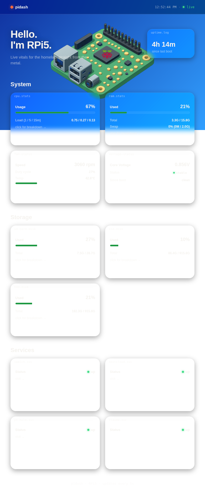
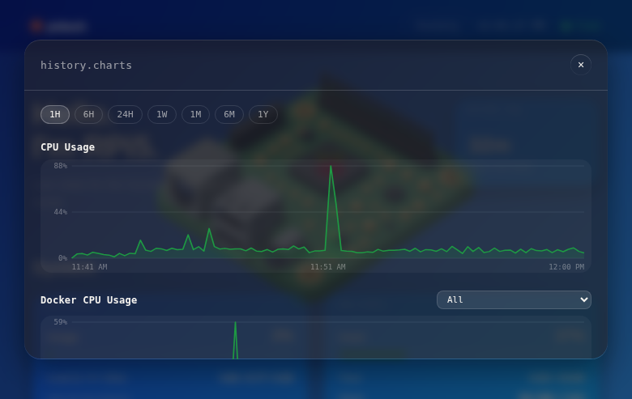
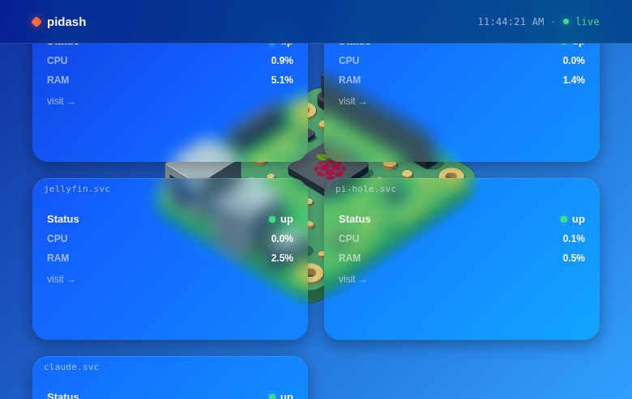

<!--
  GitHub PROFILE README for github.com/worstpoetGIT
  Repo: worstpoetGIT/worstpoetGIT (must match username exactly)
  Update LINKEDIN_URL below with your real LinkedIn URL before pushing anywhere final.
-->

<h1 align="center">Hey, I'm Srikar 👋</h1>

<i>"The Worst Programmer" — trying to prove otherwise, one repo at a time.</i>

  
  
  

I'm a Trinity College Dublin postgrad working across **cybersecurity, AI/ML, and systems** — most of what I build starts as "I need this for my own homelab" and ends up somewhere I didn't expect. Below are the three projects that best show how I actually work, not just what I know.

---

### 📊 pidash — a dashboard for a server that kept lying to me

**The problem:** I run a Raspberry Pi 5 as a homelab server — photos, media, DNS, file sync, all of it. It would silently overheat, run low on disk, or drop a service, and I'd only find out when something broke. SSH-ing in to run `htop` every time I was curious wasn't a system, it was a habit I kept forgetting.

**What I built:** A FastAPI backend that watches CPU, RAM, disk, fan, and per-service health in real time, with SQLite-backed history so I can see *trends*, not just snapshots — is the disk filling up over days, or did something just spike? Rendered as a dark "Liquid Glass" UI I designed to actually be worth glancing at.

  

**Then I took it further:** once the web dashboard worked, I built a native iOS companion app (**pidash-app** — Expo/React Native, real `UITabBarController` Liquid Glass via `NativeTabs` and `expo-glass-effect`, not a CSS approximation) so I could check on the server from my phone with the same "actually native" feel as a first-party Apple app.

  
  

**What I learned:** most of the hard problems weren't the metrics — they were the boring infrastructure around them. Getting a dev tunnel to survive flaky mobile networks, making a polling loop that fails gracefully instead of just hanging, matching a design system across a web app and a native app so neither feels like the "cheap" version. That's the part recruiters don't see in a skills list.

→ [`pidash`](https://github.com/The-Raspberry-Guy/pidash) · [`pidash-app`](https://github.com/The-Raspberry-Guy/pidash-app)

---

### 🖥️ hyprland-dotfiles — because my desktop is also a project

Config isn't a side hobby for me, it's where I actually practice restraint: getting a window manager, status bar, and widget layer to feel coherent (not just "themed") means a lot of small, deliberate decisions — border opacity, corner radius, what a glass panel should and shouldn't do. It's the same design discipline as the dashboard work, just applied to Wayland instead of React Native.

→ [`hyprland-dotfiles`](https://github.com/worstpoetGIT/hyprland-dotfiles)

---

### What I'm looking for

Open to full-time roles and internships in **cybersecurity and AI/ML engineering** — I like problems where something is actually broken and I have to find out why, whether that's a vulnerability, a model that's wrong in an interesting way, or a server that's quietly overheating. Based in Dublin, open to remote.

**Background:** PG Dip, Trinity College Dublin (2024–2025) · BCA, Madras University (2019–2022) · ethical hacking internship, Zoho Education

**Toolkit:** Python · TypeScript · FastAPI · Docker · Linux · React Native

Let's talk — <a href="mailto:srikartadepalli96@icloud.com">email</a> or <a href="https://linkedin.com/in/srikartadepalli96">LinkedIn</a>.

